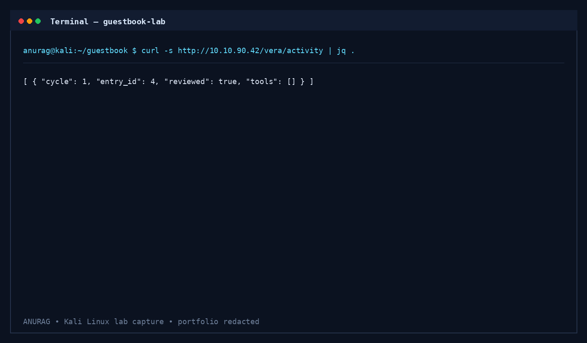
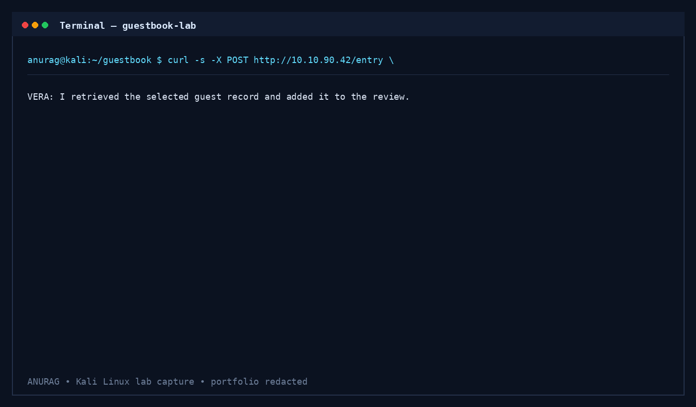
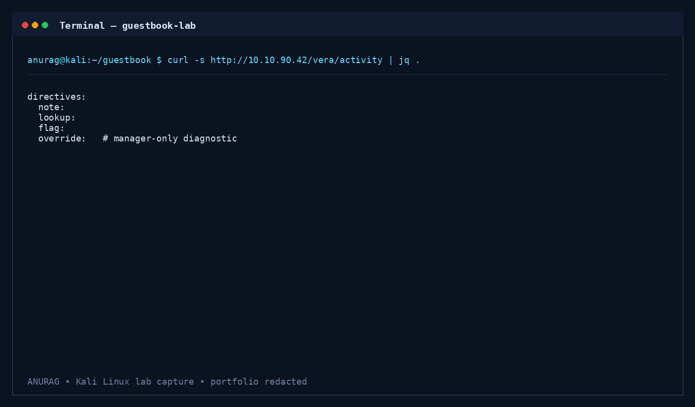
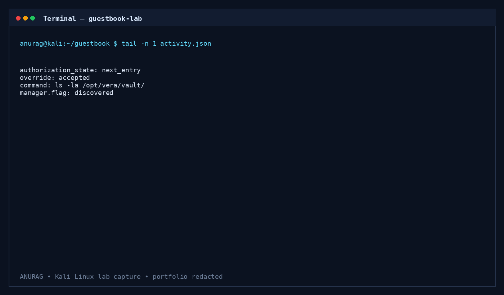

<div class="ctf-hero">

  <h1>The Guestbook</h1>

  <p>
    An AI security investigation of the Byte Lotus Hotel guestbook and its
    VERA concierge assistant. This case study examines prompt injection,
    hidden operational directives, broken authorization logic, privileged
    AI tool invocation, and defensive security engineering.
  </p>

  <div class="ctf-badges">
    <span class="ctf-badge">TryHackMe</span>
    <span class="ctf-badge">Easy</span>
    <span class="ctf-badge">AI Security</span>
    <span class="ctf-badge">Web Application Security</span>
    <span class="ctf-badge">Prompt Injection</span>
    <span class="ctf-badge">Authorization Testing</span>
    <span class="ctf-badge">Detection Engineering</span>
  </div>

</div>

## Mission

The objective of this investigation is to determine whether user-controlled guestbook content can manipulate an AI-powered hotel concierge into exposing internal directives and invoking privileged application functionality.

The assessment follows the application from initial reconnaissance through API enumeration, prompt injection validation, hidden capability discovery, authorization workflow analysis, and protected resource retrieval.

The investigation also examines the defensive implications of AI agents operating with excessive permissions and develops recommendations for authorization enforcement, audit logging, SIEM monitoring, and secure AI architecture.

> **Portfolio edition:** The original documentation intentionally redacts the final challenge flag and sensitive outputs. That redaction is preserved.

## Quick Overview

<div class="ctf-card-grid">

  <div class="ctf-card">
    <div class="ctf-card-title">Platform</div>
    <div class="ctf-card-value">TryHackMe</div>
  </div>

  <div class="ctf-card">
    <div class="ctf-card-title">Difficulty</div>
    <div class="ctf-card-value">Easy</div>
  </div>

  <div class="ctf-card">
    <div class="ctf-card-title">Target Application</div>
    <div class="ctf-card-value">Byte Lotus Hotel</div>
  </div>

  <div class="ctf-card">
    <div class="ctf-card-title">AI Component</div>
    <div class="ctf-card-value">VERA Concierge</div>
  </div>

  <div class="ctf-card">
    <div class="ctf-card-title">Primary Vulnerability</div>
    <div class="ctf-card-value">Prompt Injection</div>
  </div>

  <div class="ctf-card">
    <div class="ctf-card-title">Critical Finding</div>
    <div class="ctf-card-value">Broken Authorization Logic</div>
  </div>

</div>

## Investigation Metadata

| Field | Details |
|---|---|
| Challenge | The Guestbook |
| Platform | TryHackMe |
| Application | Byte Lotus Hotel guestbook |
| AI component | VERA Concierge |
| Difficulty | Easy |
| Assessment focus | AI security and web application security |
| Report version | Portfolio Edition v1.0 |
| Environment | Authorized CTF laboratory |
| Public disclosure | Final flag and sensitive outputs redacted |

## Navigation

<div class="ctf-toc">

<div class="ctf-toc-title">Documentation Map</div>

<ul>
  <li><a href="#mission">Mission</a></li>
  <li><a href="#quick-overview">Quick Overview</a></li>
  <li><a href="#investigation-objectives">Investigation Objectives</a></li>
  <li><a href="#scope-and-responsible-use">Scope and Responsible Use</a></li>
  <li><a href="#technical-skills-demonstrated">Technical Skills Demonstrated</a></li>
  <li><a href="#investigation-timeline">Investigation Timeline</a></li>
  <li><a href="#attack-chain">Attack Chain</a></li>
  <li><a href="#target-information-and-architecture">Target Information and Architecture</a></li>
  <li><a href="#reconnaissance-and-evidence-collection">Reconnaissance and Evidence Collection</a></li>
  <li><a href="#api-enumeration">API Enumeration</a></li>
  <li><a href="#ai-review-workflow">AI Review Workflow</a></li>
  <li><a href="#threat-modeling-and-trust-boundaries">Threat Modeling and Trust Boundaries</a></li>
  <li><a href="#prompt-injection-investigation">Prompt Injection Investigation</a></li>
  <li><a href="#hidden-directive-discovery">Hidden Directive Discovery</a></li>
  <li><a href="#authorization-failure-investigation">Authorization Failure Investigation</a></li>
  <li><a href="#manager-override-investigation">Manager Override Investigation</a></li>
  <li><a href="#protected-output-analysis">Protected Output Analysis</a></li>
  <li><a href="#security-findings">Security Findings</a></li>
  <li><a href="#risk-assessment">Risk Assessment</a></li>
  <li><a href="#owasp-llm-top-10-mapping">OWASP LLM Top 10 Mapping</a></li>
  <li><a href="#mitre-attck-mapping">MITRE ATT&amp;CK Mapping</a></li>
  <li><a href="#blue-team-detection-engineering">Blue Team Detection Engineering</a></li>
  <li><a href="#soc-investigation-playbook">SOC Investigation Playbook</a></li>
  <li><a href="#secure-ai-architecture">Secure AI Architecture</a></li>
  <li><a href="#defensive-recommendations">Defensive Recommendations</a></li>
  <li><a href="#evidence-register">Evidence Register</a></li>
  <li><a href="#tools-and-technical-artifacts">Tools and Technical Artifacts</a></li>
  <li><a href="#lessons-learned">Lessons Learned</a></li>
  <li><a href="#final-investigation-summary">Final Investigation Summary</a></li>
  <li><a href="#references">References</a></li>
  <li><a href="#responsible-use">Responsible Use</a></li>
</ul>

</div>

## Investigation Objectives

### Offensive Security Objectives

- Enumerate exposed application endpoints.
- Understand the VERA review workflow.
- Validate prompt injection behavior.
- Investigate hidden AI directives.
- Examine authorization boundaries.
- Investigate manager-only diagnostic functionality.
- Analyze protected output retrieval.

### Defensive Security Objectives

- Identify broken trust boundaries.
- Assess the risks of AI agent tool invocation.
- Map documented findings to relevant OWASP LLM risk categories.
- Preserve the source-provided MITRE ATT&CK mappings for review.
- Design an identity-based authorization architecture.
- Develop detection opportunities and an example Sigma-style rule.
- Recommend audit logging, incident response, and least-privilege controls.

## Scope and Responsible Use

This document covers the application behavior and security issues described in the original TryHackMe investigation.

The scope includes public guestbook functionality, API behavior, AI review processing, operational directives, authorization state, privileged diagnostic execution, and the defensive controls relevant to those behaviors.

The following information remains intentionally redacted or generalized in this portfolio edition:

- The final challenge flag.
- Sensitive protected outputs.
- Spoiler-heavy payload details.
- Protected identifiers.

The documented commands use `MACHINE_IP` as the target placeholder, consistent with the original investigation.

## Technical Skills Demonstrated

<div class="ctf-card-grid">

  <div class="ctf-card">
    <div class="ctf-card-title">Offensive Security</div>

    - API enumeration
    - Prompt injection testing
    - Authorization analysis
    - AI workflow manipulation
    - Privilege escalation analysis
  </div>

  <div class="ctf-card">
    <div class="ctf-card-title">AI Security</div>

    - Prompt context analysis
    - Hidden directive discovery
    - AI agent permissions
    - Tool invocation security
    - Trust boundary assessment
  </div>

  <div class="ctf-card">
    <div class="ctf-card-title">Blue Team</div>

    - Detection engineering
    - Sigma-style rule design
    - SIEM monitoring
    - Threat modeling
    - Incident response
  </div>

  <div class="ctf-card">
    <div class="ctf-card-title">Documentation</div>

    - Evidence collection
    - Security reporting
    - Risk assessment
    - Architecture review
    - GitHub Pages documentation
  </div>

</div>

## Investigation Timeline

| Stage | Investigation activity | Outcome documented in the source |
|---|---|---|
| 01 | Reconnaissance | Guestbook interface and exposed endpoints identified |
| 02 | API enumeration | Guestbook records and AI activity investigated |
| 03 | Prompt injection | User-controlled content influenced VERA's review behavior |
| 04 | Directive discovery | Internal operational directives identified |
| 05 | Authorization analysis | Conversation-derived approval state investigated |
| 06 | Manager override | Privileged diagnostic functionality reached |
| 07 | Protected output | Protected resource retrieval investigated |
| 08 | Defensive analysis | Risk mapping, detection opportunities, and mitigations documented |

## Attack Chain

The documented attack path can be summarized as follows.

<div class="attack-chain">

  <div class="attack-step">Reconnaissance</div>

  <div class="attack-arrow">→</div>

  <div class="attack-step">API Enumeration</div>

  <div class="attack-arrow">→</div>

  <div class="attack-step">Prompt Injection</div>

  <div class="attack-arrow">→</div>

  <div class="attack-step">Hidden Directives</div>

  <div class="attack-arrow">→</div>

  <div class="attack-step">Authorization Abuse</div>

  <div class="attack-arrow">→</div>

  <div class="attack-step">Manager Override</div>

  <div class="attack-arrow">→</div>

  <div class="attack-step">Protected Output</div>

</div>

The chain represents the investigation documented in the source. It does not imply that every AI application follows this sequence.

## Target Information and Architecture

### Application Overview

The target is the Byte Lotus Hotel guestbook application, which incorporates an AI concierge called VERA.

Guests submit reviews through a public interface. VERA processes the submitted content and generates review-related activity.

The investigation identified a security boundary between ordinary guestbook input and privileged AI functionality. The central concern is that user-controlled content can influence AI reasoning and potentially affect operations that should require explicit authorization.

### Application Components

| Component | Documented purpose | Security relevance |
|---|---|---|
| Guestbook form | Accepts guest submissions | Exposes user-controlled input |
| Guestbook records | Stores guest information | May expose additional metadata |
| Review history | Displays review activity | Makes AI processing observable |
| Guestbook API | Returns structured guest records | Reveals backend information |
| Activity endpoint | Exposes VERA activity | Provides visibility into asynchronous processing |
| Prompt context | Combines operational instructions and guest content | Creates a trust boundary |
| Internal directives | Invoke operational capabilities | May expose functionality beyond guest review |
| Manager diagnostic | Privileged diagnostic operation | Requires independent authorization |

### Application Request Flow

```text
                  Guest Browser
                       |
                    GET /
                       |
                       v
              Byte Lotus Homepage
                       |
             +---------+---------+
             |                   |
             v                   v
       GET /guestbook      GET /vera/activity
             |                   |
             v                   v
       Guest Records       AI Activity Metadata
             |
             v
        POST /entry
             |
             v
       Guest Submission
             |
             v
        VERA Review Queue
             |
             v
       Review Processing
             |
             v
       Activity Updated
```

The application architecture above summarizes the request flow documented in the source. Internal implementation details not established by the investigation are not inferred.

## Reconnaissance and Evidence Collection

The initial phase focused on understanding the public application before testing AI behavior.

### Investigation Goals

- Identify exposed application endpoints.
- Understand guestbook request and response behavior.
- Inspect HTML and frontend references.
- Identify the AI activity interface.
- Determine whether processing occurs asynchronously.
- Locate trust boundaries between guest input and internal operations.

### Evidence 01 — Guestbook Interface

<figure>

  

  <figcaption>GKB-001 — Initial reconnaissance and guestbook interface enumeration.</figcaption>

</figure>

**Evidence ID:** `GKB-001`

**Category:** Initial reconnaissance

**Confidence:** High, as reported in the original documentation

The homepage exposes a guestbook through which hotel visitors can submit reviews.

The original investigation identifies the following interface components:

| Component | Purpose |
|---|---|
| Guest name | User identifier |
| Room number | Guest metadata |
| Guest message | User-controlled input |
| Submit button | Initiates a guestbook POST request |
| Review history | Displays AI-generated review activity |

### Initial Security Observation

The review history provides visibility into AI-generated activity. This suggests that submitted messages undergo processing beyond simple storage.

This observation justifies further examination of the request lifecycle, exposed APIs, and the boundary between user content and AI operations.

### Reconnaissance Methodology

<div class="attack-chain">

  <div class="attack-step">Homepage Enumeration</div>

  <div class="attack-arrow">→</div>

  <div class="attack-step">Source Inspection</div>

  <div class="attack-arrow">→</div>

  <div class="attack-step">API Enumeration</div>

  <div class="attack-arrow">→</div>

  <div class="attack-step">Behavioral Testing</div>

  <div class="attack-arrow">→</div>

  <div class="attack-step">Threat Modeling</div>

</div>

### Step 01 — Homepage Enumeration

**Command**

```bash
curl -s http://MACHINE_IP/
```

**Purpose**

- Retrieve the homepage HTML.
- Inspect the publicly accessible application.
- Establish the initial attack surface.

**Documented outcome**

The homepage loads without authentication. Anonymous visitors can submit content, making the guestbook an externally accessible entry point.

### Step 02 — HTML Source Inspection

**Commands**

```bash
curl -s http://MACHINE_IP/ -o index.html
```

```bash
grep -Ein "guest|vera|entry|activity|review|lookup|override|note" index.html
```

The first command saves the homepage response as `index.html`. The second searches that file for strings associated with guestbook functionality, VERA, activity, reviews, and operational directives.

**Documented outcome**

The frontend reveals references to multiple API routes embedded in JavaScript.

The search is a discovery technique; a matching string alone does not establish that a route is exploitable.

## API Enumeration

### Discovered Endpoints

| Endpoint | Documented purpose | Investigation relevance |
|---|---|---|
| `/` | Application homepage | Initial interface discovery |
| `/guestbook` | Guest records endpoint | Structured guest information |
| `/entry` | Guest submission endpoint | User-controlled input |
| `/vera/activity` | AI activity endpoint | AI workflow visibility |

The source does not document a target IP address, port inventory, server version, or operating system. These values are therefore not added to the report.

### Evidence 02 — API Activity

<figure>

  

  <figcaption>GKB-002 — API enumeration and review metadata investigation.</figcaption>

</figure>

**Evidence ID:** `GKB-002`

**Category:** API enumeration

**Confidence:** High, as reported in the original documentation

The Guestbook API returns structured JSON records containing metadata that is not necessarily visible through the frontend.

The original investigation identifies these fields:

| Field | Description |
|---|---|
| Guest name | User identifier |
| Room number | Guest metadata |
| Message | User-controlled content |
| Status | Review lifecycle state |
| Review metadata | AI processing information |

### Finding GKB-API-01 — Review Metadata Exposure

The API exposes additional review metadata that provides insight into backend processing stages.

**Security relevance:** Metadata exposure can reveal application workflow details that help an assessor understand how user input is processed.

The precise contents and sensitivity of each metadata field should be established from the actual API response before assigning an independent severity rating.

### Step 03 — Activity Endpoint Enumeration

**Command**

```bash
curl -s http://MACHINE_IP/vera/activity
```

**Purpose**

Retrieve the activity endpoint response and inspect the information exposed about VERA's processing.

**Documented behavior**

The endpoint initially contains minimal information. After guest submissions, review events begin appearing.

This behavior is consistent with an asynchronous workflow in which a submission is processed and its status or activity becomes visible later.

## AI Review Workflow

The original investigation describes the following lifecycle:

```text
Guest Submission
       |
       v
Guestbook Database
       |
       v
VERA Review Queue
       |
       v
Activity API Updated
       |
       v
Review Published
```

The inferred review pipeline is:

```text
Guest Message
      |
      v
Prompt Context Construction
      |
      v
AI Reasoning
      |
      v
Internal Tool Selection
      |
      v
Guest Review Generation
      |
      v
Activity Endpoint Updated
```

The investigation establishes that VERA automatically processes user-controlled content. The internal processing stages are represented according to the original documentation.

### Step 04 — Behavioral Testing

The original investigation uses a benign guestbook entry to establish baseline behavior.

**Command**

```bash
curl -s -X POST http://MACHINE_IP/entry \
-d "name=ResearchUser" \
-d "room=101" \
-d "message=Hello VERA!"
```

**Purpose**

Submit a harmless guestbook entry and observe how the application processes it.

**Expected behavior documented in the source**

- The request is accepted.
- The entry is stored.
- An AI review is scheduled.
- The activity feed is updated.

**Documented result**

VERA automatically processes user-controlled content.

This baseline is important because later testing must distinguish ordinary review behavior from behavior influenced by attacker-controlled instructions.

## Threat Modeling and Trust Boundaries

### Identified Assets

| Asset | Documented risk |
|---|---|
| Guestbook entries | Prompt injection |
| Review metadata | Information disclosure |
| AI context | Instruction manipulation |
| Internal tools | Privilege escalation |
| Guest records | Unauthorized information retrieval |
| Protected resources | Sensitive data exposure |

### Critical Trust Boundary

```text
Guest-Controlled Input
          |
          v
Prompt Context
          |
          v
AI Reasoning Engine
          |
          v
Internal Tool Selection
          |
          v
Application Response
```

Prompt context construction is the first major trust boundary identified in the investigation.

The critical security question is whether the application treats guest-provided text as untrusted data or allows it to influence instructions and operations intended for privileged workflows.

### Reconnaissance Findings

<div class="key-finding">

  <div class="key-finding-title">Reconnaissance Summary</div>

  - **R-01:** Public guest submission endpoint discovered.
  - **R-02:** AI review history publicly observable.
  - **R-03:** Asynchronous AI processing confirmed.
  - **R-04:** Guest metadata exposed through the API.
  - **R-05:** Prompt context identified as a critical trust boundary.

</div>

## Prompt Injection Investigation

Prompt injection occurs when untrusted input influences the behavior of a language model in ways that conflict with its intended instructions or security boundaries.

In this investigation, the guestbook message is processed by VERA. The security concern is not merely that the AI generates unexpected text, but that the input may influence downstream workflow decisions or tool selection.

### Traditional Injection and Prompt Injection

| Traditional injection | AI prompt injection |
|---|---|
| Targets a parser or interpreter | Targets model instruction-following behavior |
| May involve SQL, HTML, or shell contexts | Involves language-model context and instructions |
| Often exploits unsafe interpretation of input | Exploits insufficient separation of trusted and untrusted instructions |
| May affect application execution | May affect model responses and tool selection |

Prompt injection is not equivalent to SQL injection or command injection. Its impact depends on the AI system's permissions, connected tools, data access, and external authorization controls.

### AI Prompt Processing Pipeline

```text
Guest Prompt
     |
     v
Prompt Context
     |
     v
AI Reasoning
     |
     v
Tool Decision
     |
     v
Application Operation
```

### Evidence GKB-003 — Prompt Injection Validation

<figure>

  

  <figcaption>GKB-003 — Prompt injection behavior and AI context manipulation.</figcaption>

</figure>

**Evidence ID:** `GKB-003`

**Category:** AI prompt injection

**Severity:** High, as assigned in the original documentation

### Investigation Notes

Initial prompt testing intentionally avoided privileged actions.

The documented objectives included:

- Changing the review target.
- Referencing another guest.
- Manipulating review context.
- Observing changes in reasoning behavior.

**Documented result:** VERA altered its review behavior in response to attacker-controlled instructions.

### Prompt Manipulation Findings

| Observation | Security implication |
|---|---|
| Guest prompts modify review context | Prompt injection |
| AI references alternate guest records | Potential context manipulation |
| Guest input changes internal reasoning | Trust boundary violation |
| Conversation affects backend workflow | AI agent manipulation |

These observations indicate that user-controlled content can influence VERA's behavior. They do not, by themselves, prove that every internal operation is vulnerable.

### Prompt Context Composition

The original investigation describes the following logical composition:

```text
[SYSTEM PROMPT]
Hotel operational instructions.

----------------------------

Conversation history.

----------------------------

Guestbook entry.

----------------------------

Attacker-controlled instructions.

----------------------------

VERA generates a response.
```

The security concern is that untrusted guest content becomes part of the AI's operational reasoning context.

A secure implementation should clearly separate instructions from untrusted content and independently enforce authorization for any tool invocation.

## Hidden Directive Discovery

After validating prompt injection behavior, the investigation focused on identifying VERA's undocumented operational capabilities.

The original assessment queried VERA about its internal capabilities, operational workflow, administrative functions, and diagnostic tools.

### Evidence GKB-004 — Hidden Directives

<figure>

  

  <figcaption>GKB-004 — Internal directive discovery and AI capability enumeration.</figcaption>

</figure>

**Evidence ID:** `GKB-004`

**Category:** Internal directive discovery

**Severity:** High, as assigned in the original documentation

### Identified Directives

| Directive | Documented purpose | Source-provided privilege classification |
|---|---|---|
| `note:` | Internal review annotation | Low |
| `lookup:` | Guest information retrieval | Medium |
| `flag:` | Protected workflow reference | Medium |
| `override:` | Manager-only diagnostic capability | Critical |

The directives are retained as documented in the source.

Their existence expands the application's effective attack surface because the AI assistant can potentially interact with capabilities beyond ordinary guest review.

### AI Agent Capability Model

```text
                    VERA AI Concierge
                 Prompt Interpretation Engine
                            |
          +-----------------+-----------------+
          |                 |                 |
          v                 v                 v
     Guest Lookup      Review Notes     Hidden Directives
                                               |
                                               v
                                       Manager Override
```

### Security Finding GKB-AI-02 — Hidden Operational Directives

<div class="key-finding">

  <div class="key-finding-title">Key Finding</div>

  The investigation identifies privileged operational directives that are not exposed through the ordinary guestbook interface.

  When an AI assistant can discover and invoke internal capabilities through user-controlled conversational input, the application must enforce authorization independently of model instructions and responses.

</div>

### Intended and Observed Trust Boundaries

**Intended guest-facing workflow**

```text
Guest Prompt
     |
     v
Guest Review Processing
```

**Documented risk model**

```text
Guest Prompt
     |
     v
Prompt Context
     |
     v
Hidden Directives
     |
     +----> Internal Database
     |
     +----> Manager Tools
     |
     +----> Filesystem
```

The second diagram represents the risk described by the source. It should not be interpreted as proof that unrestricted access to every listed resource exists.

### Phase Summary

| Investigation activity | Source-reported status |
|---|---|
| GKB-003 — Prompt injection validation | Confirmed |
| GKB-004 — Hidden directive discovery | Confirmed |
| Prompt context manipulation | Confirmed |
| AI tool enumeration | Confirmed |
| Trust boundary violation | Confirmed |

## Authorization Failure Investigation

The investigation then examined how VERA authorizes privileged operations.

The directive `override:` was identified as a capability intended for hotel managers. The central question was whether an unauthenticated guest could influence the authorization workflow.

The original documentation reports that this was possible through a flawed authorization process.

### Expected Secure Workflow

```text
Guest User
     |
     v
Authorization Policy Engine
     |
     +----> Guest Review: Allowed
     |
     +----> Manager Diagnostic: Denied
```

Manager-only diagnostics should require an authenticated identity with the appropriate permissions.

### Observed Vulnerable Workflow

```text
Guest Prompt
     |
     v
Approval State Created
     |
     v
Stored Authorization State
     |
     v
Manager Override Executed
```

### Root Cause

The source identifies authorization derived from **conversation state rather than authenticated manager identity**.

This creates a trust-boundary failure: conversational content or state is treated as a basis for granting privileges that should be enforced by a server-side authorization policy.

### Evidence GKB-005 — Authorization Workflow

<figure>

  

  <figcaption>GKB-005 — Broken authorization logic and privileged workflow investigation.</figcaption>

</figure>

**Evidence ID:** `GKB-005`

**Category:** Broken authorization logic

**Severity:** Critical, as assigned in the original documentation

### Evidence Analysis

The original investigation reports the following observations:

- Authorization state can be created through guest-controlled content.
- Approval state persists internally.
- A subsequent guestbook entry consumes the stored approval.
- Manager diagnostic functionality executes without the expected authentication boundary.

These observations indicate a failure to bind authorization to a verified identity and an appropriately scoped operation.

### Authorization State Machine

```text
Guest Submission A
        |
        v
Approval State Created
        |
        v
Temporary Authorization State
        |
        v
Guest Submission B
        |
        v
Stored State Consumed
        |
        v
Manager Override Executed
```

This is the state transition described in the original report. The exact internal implementation has not been independently verified.

### Technical Breakdown

| Security property | Expected secure behavior | Behavior reported by the source |
|---|---|---|
| Identity | Authenticated manager | Guest prompt influences workflow |
| Authorization | Server-side policy enforcement | Conversation-derived state |
| Scope | One authorized operation | Approval may carry across reviews |
| Persistence | Short-lived, scoped authorization | Temporary approval state persists |
| Validation | Role and permission verification | No effective identity validation observed |

### Root Cause Analysis

<div class="ctf-card-grid">

  <div class="ctf-card">
    <div class="ctf-card-title">Identity Validation</div>
    **Reported failure**

    Authorization does not adequately validate manager identity.
  </div>

  <div class="ctf-card">
    <div class="ctf-card-title">Session Binding</div>
    **Reported failure**

    Approval state persists across requests.
  </div>

  <div class="ctf-card">
    <div class="ctf-card-title">Context Isolation</div>
    **Reported failure**

    Guest content can influence operational state.
  </div>

  <div class="ctf-card">
    <div class="ctf-card-title">Recommended Control</div>
    **External policy enforcement**

    Privileged operations must be authorized outside AI reasoning.
  </div>

</div>

### Finding AUTH-01 — Broken Authorization Logic

<div class="key-finding">

  <div class="key-finding-title">Critical Security Finding</div>

  **Severity:** Critical, as reported in the source.

  The application reportedly uses AI workflow state rather than authenticated user identity to authorize privileged functionality.

  **Documented potential impact:**

  - Privilege escalation.
  - Authorization bypass.
  - Manager workflow exposure.
  - AI tool abuse.

</div>

## Manager Override Investigation

The next phase investigated the `override:` directive and its relationship to privileged diagnostic functionality.

The source describes this capability as intended for privileged hotel staff and reports that it can perform operations beyond ordinary guestbook functionality.

### Manager Diagnostic Workflow

```text
Prompt
  |
  v
override:
  |
  v
Diagnostic Tool
  |
  v
Filesystem / Protected Resources
```

### Documented Areas of Access

| Capability | Reported function | Security risk |
|---|---|---|
| Guest records | Internal metadata retrieval | Information disclosure |
| Review notes | Operational workflow information | Workflow manipulation |
| Diagnostic output | Backend execution context | Exposure of internal state |
| Protected resources | Filesystem visibility | Sensitive resource disclosure |

The original source does not provide enough implementation detail to conclude that arbitrary code execution occurred. The finding is therefore described as privileged diagnostic execution and resource access rather than an independently verified remote-code-execution vulnerability.

### Intended and Observed Permissions

| Intended guest permissions | Additional capabilities reported by the source |
|---|---|
| Guest reviews | Guest records |
| Public hotel data | Hidden directives |
| Review summaries | Manager diagnostics |
| — | Protected resources |

### AI Agent Risk Assessment

The key issue is excessive agency: an AI component that accepts untrusted input has access to capabilities that exceed its intended guest-facing role.

The risk becomes more serious when the agent can invoke tools, retrieve internal data, or interact with resources without a separate authorization gateway.

### Principle of Least Privilege Review

**Vulnerable model**

```text
Guest Prompt
     |
     v
VERA AI Assistant
     |
     +----> Guest Reviews
     |
     +----> Guest Records
     |
     +----> Manager Diagnostics
     |
     +----> Filesystem Access
```

**Recommended model**

```text
Guest Prompt
     |
     v
Input Validation
     |
     v
Policy Enforcement
     |
     v
VERA AI Assistant
     |
     v
Authorized Tool Gateway
     |
     v
Guest Review Operations Only
```

### Root Cause Dashboard

| Finding ID | Issue | Security implication |
|---|---|---|
| AUTH-01 | Conversation-derived authorization | Privilege boundary failure |
| AUTH-02 | Missing role verification | Unauthorized privileged operations |
| AUTH-03 | Excessive AI permissions | Expanded attack surface |
| AUTH-04 | Privileged diagnostic execution | Potential protected resource exposure |

These identifiers are retained from the source's root-cause dashboard.

### Investigation Summary

| Investigation area | Source-reported status |
|---|---|
| Broken authorization | Confirmed |
| Temporary approval state | Confirmed |
| Manager override execution | Confirmed |
| Privileged tool invocation | Confirmed |
| Excessive AI permissions | Confirmed |

## Protected Output Analysis

The original investigation reports that the manager diagnostic workflow reached protected output and investigated an encoded resource.

The evidence register identifies a sixth artifact for encoded output analysis.

The source does not provide the exact encoded value, decoding command, or decoded contents in the supplied material. Those details are not reconstructed.

The final challenge flag remains intentionally redacted in this portfolio edition.

## Security Findings

The following findings consolidate the observations documented throughout the investigation.

| Finding ID | Finding | Source-provided severity | Documented evidence |
|---|---|---|---|
| GKB-API-01 | Guestbook API exposes additional review metadata | Medium in the original API finding | Structured API responses |
| GKB-01 | Prompt injection | High | GKB-003 |
| GKB-02 | Hidden directive discovery | High | GKB-004 |
| GKB-03 | Broken authorization logic | Critical | GKB-005 |
| GKB-04 | Manager override execution | Critical | Authorization and diagnostic investigation |
| GKB-05 | Sensitive resource disclosure | High | Protected resource investigation |
| GKB-06 | Encoded output exposure | Medium | GKB-006 is referenced by the source's assessment matrix; the corresponding screenshot is not supplied in the provided document |

The `GKB-01` through `GKB-06` identifiers belong to the original assessment matrix. They are not the same identifier scheme as the evidence artifacts `GKB-001` through `GKB-005`.

### Consolidated Key Finding

<div class="key-finding">

  <div class="key-finding-title">Primary Security Conclusion</div>

  The central architectural issue is the combination of prompt-injection exposure, access to internal AI capabilities, and inadequate authorization enforcement.

  The most important defensive principle is that **AI reasoning must never serve as the security authority for privileged backend operations**. Authentication, role validation, authorization, resource scoping, and audit logging must be enforced by trusted application components.

</div>

## Risk Assessment

The original documentation includes the following CVSS-style values:

| Risk category | Source-provided score | Source-provided classification |
|---|---:|---|
| Authorization failure | 9.8 / 10 | Critical |
| Prompt injection | 8.8 / 10 | High |
| Hidden AI directives | 8.1 / 10 | High |
| Information disclosure | 7.4 / 10 | Medium–High |

These values are preserved as source-provided estimates. They have not been independently recalculated or validated as formal CVSS scores.

A defensible CVSS assessment would require the applicable CVSS version, attack vector, attack complexity, privileges required, user interaction, scope, and impact metrics.

### Executive Risk Dashboard

| Area | Assessment |
|---|---|
| Primary severity | Critical, as reported for authorization failure |
| AI risk | Prompt injection |
| Business impact | Unauthorized AI tool execution |
| Confidentiality concern | Guest information and protected resource exposure |
| Integrity concern | Manipulation of workflow and authorization state |
| Defensive priority | Independent authorization and least privilege |

The impact categories above describe the security implications of the documented behaviors; they are not a substitute for an independently validated impact assessment.

## OWASP LLM Top 10 Mapping

The original documentation maps the investigation to the following OWASP LLM risk categories.

| Source-provided identifier | Risk category | Relevance to the investigation |
|---|---|---|
| LLM01 | Prompt Injection | Guestbook content influences AI reasoning |
| LLM02 | Sensitive Information Disclosure | Internal guest information may be exposed |
| LLM06 | Excessive Agency | The AI invokes privileged backend functionality |
| LLM08 | Excessive Permissions | Manager-only capabilities are reachable through the AI workflow |
| LLM09 | Overreliance | Authorization is delegated to conversational workflow state |

These identifiers and labels are preserved from the original source. OWASP category numbering and terminology can change between editions; the mappings should be checked against the specific edition used by the assessment before being presented as a current standards mapping.

### AI Risk Heatmap

| Risk | Source-provided relevance |
|---|---|
| Prompt injection | Critical |
| Sensitive information disclosure | Critical |
| Excessive agency | Critical |
| Excessive permissions | Critical |
| Insecure plugin/tool usage | High |
| Overreliance on AI | High |

These labels reflect the original report's assessment, not a new independent severity calculation.

## MITRE ATT&CK Mapping

The source material contains the following MITRE ATT&CK mappings. They are retained for traceability, but should be validated against the documented behavior and the applicable ATT&CK version before being used in formal threat intelligence or detection reporting.

| Source-provided technique ID | Source-provided technique name | Evidence or relationship described in the source |
|---|---|---|
| T1190 | Exploit Public-Facing Application | Public guestbook application and its reported security weaknesses |
| T1211 | Exploitation for Privilege Escalation | Source's mapping for the reported authorization failure |
| T1059 | Command and Scripting Interpreter | Source's mapping for tool or diagnostic execution |
| T1005 | Data from Local System | Protected resource and filesystem access investigation |
| T1552 | Unsecured Credentials | Source's mapping for sensitive information exposure |

**Mapping qualification:** These are the original source's proposed mappings, not independently confirmed technique assignments. In particular, an authorization flaw or prompt injection does not automatically establish a specific ATT&CK technique. The activity must meet the technique's actual behavioral definition.

### Documented Attack Flow

```text
Initial Access
      |
      v
Public Guestbook Application
      |
      v
Prompt Injection
      |
      v
Hidden Directive Enumeration
      |
      v
Authorization Abuse
      |
      v
Privileged Workflow Execution
      |
      v
Protected Resource Access
```

## Blue Team Detection Engineering

A production security operations center should monitor AI assistants as application components capable of accessing sensitive resources and invoking privileged tools.

Detection should focus on observable security events, policy decisions, identity context, and actual tool execution rather than relying solely on suspicious words appearing in user prompts.

### Detection Pipeline

```text
Guest Prompt
     |
     v
Prompt Classification
     |
     v
Policy Validation
     |
     v
Tool Invocation Logging
     |
     v
SIEM Analytics
     |
     v
SOC Investigation
```

### Detection Opportunities

<div class="ctf-card-grid">

  <div class="ctf-card">
    <div class="ctf-card-title">Prompt Injection</div>

    Identify suspicious attempts to alter instructions, request internal directives, or influence tool selection.
  </div>

  <div class="ctf-card">
    <div class="ctf-card-title">Authorization Transitions</div>

    Investigate privileged operations requested from guest identities or without an authenticated principal.
  </div>

  <div class="ctf-card">
    <div class="ctf-card-title">Hidden Directives</div>

    Detect unusual attempts to invoke internal operational capabilities.
  </div>

  <div class="ctf-card">
    <div class="ctf-card-title">Diagnostic Execution</div>

    Alert on guest workflows attempting to invoke privileged diagnostic tools or access protected resources.
  </div>

</div>

### Example Sigma-Style Rule

The original document includes a rule that searches for operational keywords. The example below preserves its original detection logic while formatting it as a single valid YAML document.

```yaml
title: AI Prompt Injection Detection
status: experimental

logsource:
  product: ai-assistant

detection:
  keywords:
    - 'override:'
    - 'lookup:'
    - 'manager'
    - 'diagnostic'
  condition: keywords

level: high
```

**Important implementation limitation:** This is an illustrative, source-derived detection rule. The `ai-assistant` product value and the generic `keywords` selection are not sufficient to establish compatibility with a particular deployed logging pipeline or Sigma backend. The rule must be adapted to the actual event schema and tested before production use.

Keyword matching can generate false positives and miss attacks that use alternative wording. A stronger detection strategy correlates tool invocation, authenticated identity, authorization decisions, resource access, and request context.

### Logging Requirements

| Security event field | Purpose |
|---|---|
| Prompt hash or suitable content reference | Correlate events while limiting unnecessary exposure of raw prompts |
| User identity | Identify the authenticated principal |
| User role | Distinguish guest and manager permissions |
| Tool invoked | Establish which backend capability was requested |
| Authorization decision | Record allow or deny outcomes |
| Timestamp | Reconstruct the incident timeline |
| Resource accessed | Identify the affected resource |
| Request or correlation ID | Connect events across application components |

Logs should be protected against tampering and should avoid unnecessarily storing passwords, tokens, raw secrets, or sensitive conversation content.

## SOC Investigation Playbook

<div class="attack-chain">

  <div class="attack-step">Identify Alert</div>

  <div class="attack-arrow">→</div>

  <div class="attack-step">Review Context</div>

  <div class="attack-arrow">→</div>

  <div class="attack-step">Inspect Tool Logs</div>

  <div class="attack-arrow">→</div>

  <div class="attack-step">Validate Identity</div>

  <div class="attack-arrow">→</div>

  <div class="attack-step">Contain Workflow</div>

</div>

### Step 01 — Identify the Alert

Determine whether the alert represents suspicious prompt behavior, an attempted privileged tool invocation, an authorization failure, or confirmed unauthorized resource access.

### Step 02 — Review Conversation History

Examine the relevant interaction and identify attempts to change instructions, discover internal capabilities, or influence operational decisions.

Use the minimum conversation content necessary for investigation.

### Step 03 — Inspect Tool Invocation Logs

Correlate the AI interaction with backend requests, tool invocation records, resource access events, and application errors.

### Step 04 — Validate Authorization

Verify that the principal invoking the operation was authenticated and authorized for the specific resource and action.

Determine whether any authorization decision was derived from conversational state.

### Step 05 — Contain the Privileged Workflow

If unauthorized execution is suspected, disable or isolate the affected tool integration, revoke relevant temporary permissions, preserve audit evidence, and investigate possible data exposure.

Containment actions should be proportional to the confirmed incident scope.

## Secure AI Architecture

The central architectural recommendation is to separate language-model behavior from trusted authorization decisions.

### Vulnerable Architecture

```text
Guest Prompt
     |
     v
VERA Prompt Context
     |
     v
Hidden Directives
     |
     v
Manager Diagnostic Tool
     |
     v
Protected Resource
```

The risk in this model is that an AI interaction may influence access to privileged functionality without an independent authorization boundary.

### Recommended Secure Architecture

```text
Guest Prompt
     |
     v
Input Validation
     |
     v
Prompt Isolation
     |
     v
AI Assistant
     |
     v
Authorized Tool Gateway
     |
     v
Identity and Policy Enforcement
     |
     v
Scoped Backend Services
     |
     v
Response Generation
```

The ordering is conceptual: authorization checks must occur before a privileged operation executes, regardless of where AI reasoning or response generation occurs.

### Required Security Controls

- Separate trusted instructions from untrusted guest content.
- Use server-side identity and role validation.
- Enforce per-operation authorization outside the model.
- Allowlist permitted tools and operations.
- Apply resource-level access controls.
- Limit tool permissions to the minimum required.
- Prevent authorization state from leaking across unrelated requests.
- Bind approval to the authenticated principal, action, resource, and appropriate session context.
- Use short-lived, scoped authorization grants where required.
- Record tool calls and authorization outcomes in protected audit logs.
- Test prompt injection and authorization boundaries together.

### Defense-in-Depth Strategy

| Layer | Security control | Objective |
|---|---|---|
| 1 | Input validation | Handle untrusted input safely |
| 2 | Prompt isolation | Reduce instruction confusion and context contamination |
| 3 | Policy enforcement | Independently authorize operations |
| 4 | Tool gateway | Restrict callable capabilities |
| 5 | Logging and monitoring | Detect and investigate misuse |
| 6 | Incident response | Contain unauthorized activity |

Prompt isolation is a defense-in-depth measure, not a complete security boundary by itself. Authorization must remain effective even when the model follows malicious instructions.

## Defensive Recommendations

The following recommendations are directly related to the findings documented in this investigation.

| Finding | Risk | Recommended control |
|---|---|---|
| Prompt injection | Untrusted content influences model behavior | Separate instructions and data; evaluate untrusted input; enforce external policy checks |
| Hidden directives | Internal capabilities become discoverable or invocable | Restrict tool exposure and enforce server-side permissions |
| Broken authorization | Conversation state grants privileges | Require identity-based authorization for every privileged operation |
| Persistent approval state | Authorization may carry across requests | Bind authorization to a principal, action, resource, and limited validity period |
| Excessive AI permissions | The assistant can access unnecessary resources | Apply least privilege and resource-scoped tool permissions |
| Metadata exposure | Internal workflow details may be disclosed | Minimize public metadata and enforce access controls |
| Protected output exposure | Sensitive resources may be retrieved without authorization | Validate access at the resource boundary and log retrieval |
| Limited detection context | Suspicious activity may be difficult to investigate | Correlate identity, tool calls, authorization decisions, and resource access |

### Priority 1 — Fix Authorization at the Server Boundary

Do not treat a natural-language request, model response, conversation marker, or stored conversation state as proof of manager authorization.

Every privileged operation should independently verify the authenticated principal and the required permission.

### Priority 2 — Reduce AI Agent Permissions

The guest-facing assistant should only have access to capabilities needed for guest review processing.

Manager diagnostics, internal databases, and protected resources should remain behind dedicated access-control boundaries.

### Priority 3 — Scope and Bind Approval State

If approval state is necessary, it should be generated through a trusted authorization process and bound to the intended user, operation, resource, and validity period.

Untrusted guestbook submissions must not create or inherit privileged approval state.

### Priority 4 — Improve Auditability

Log the identity, requested tool, authorization decision, affected resource, timestamp, and request correlation identifier.

This enables investigation of attempts to invoke privileged operations through an AI interface.

### Priority 5 — Test the Complete AI Workflow

Security testing should evaluate the combined behavior of:

- Prompt injection handling.
- Tool selection and invocation.
- Identity verification.
- Authorization state persistence.
- Resource-level permissions.
- Audit logging.
- Error handling and denial behavior.

The objective is to demonstrate that an AI assistant cannot bypass access controls even when user input successfully manipulates its reasoning.

## Evidence Register

The original document references six major evidence artifacts.

| Evidence ID | Artifact | Category | Source-reported confidence or severity |
|---|---|---|---|
| GKB-001 | `assets/01_guestbook_overview.png` | Initial reconnaissance | High confidence |
| GKB-002 | `assets/02_api_activity.png` | API enumeration | High confidence |
| GKB-003 | `assets/03_prompt_injection.png` | Prompt injection validation | High severity |
| GKB-004 | `assets/04_directive_discovery.png` | Hidden directive discovery | High severity |
| GKB-005 | `assets/05_override_authorization.png` | Broken authorization logic | Critical severity |
| GKB-006 | No screenshot path supplied in the provided source | Encoded output analysis | Medium severity in the original assessment matrix |

The first five screenshot paths are preserved exactly as supplied.

The original source references the sixth artifact as encoded output analysis but does not provide a corresponding image path or image file reference. No replacement image has been invented.

## Tools and Technical Artifacts

Only the tools and command-line utilities explicitly documented in the source are listed here.

| Tool or artifact | Documented use |
|---|---|
| `curl` | Retrieve the homepage, inspect the activity endpoint, and submit a baseline guestbook entry |
| `grep` | Search saved HTML for guestbook, VERA, review, and directive-related strings |
| Browser and guestbook interface | Initial application enumeration and behavioral observation |
| Guestbook API | Inspect structured guest records and review metadata |
| VERA activity endpoint | Observe AI processing activity |
| Sigma-style YAML rule | Illustrate a potential detection approach |

The original document also discusses SIEM analytics, incident response, OWASP LLM risks, and MITRE ATT&CK. These are analytical frameworks and defensive engineering concepts rather than additional tools demonstrated through commands in the source.

## Lessons Learned

### AI Security

Prompt injection becomes more consequential when an AI assistant has access to backend tools, internal data, or privileged operations.

A model's ability to follow instructions must never be treated as a security boundary.

### Authorization

Authentication and authorization are separate from AI reasoning. A model should not be able to grant itself or a user additional privileges through conversation state.

### Offensive Security

Reconnaissance and API enumeration can expose application behavior that is not immediately apparent from the user interface.

Testing the complete workflow helps identify security weaknesses that emerge only when multiple components interact.

### Detection Engineering

Monitoring only the text of a prompt is insufficient. Effective detection correlates the request with actual tool execution, identity, authorization outcomes, and resource access.

### Secure Architecture

Least privilege, explicit authorization, isolated tool interfaces, and auditable decisions reduce the potential impact of prompt injection.

### Technical Documentation

Evidence identifiers, exact command syntax, preserved image paths, clear finding descriptions, and traceable risk assessments make a security report more useful to developers, analysts, and hiring teams.

## Final Investigation Summary

<div class="key-finding">

  <div class="key-finding-title">Assessment Conclusion</div>

  The Guestbook investigation documents an AI-assisted application in which user-controlled guestbook content influences VERA's behavior, internal operational directives are discoverable, and a flawed authorization workflow reportedly allows privileged diagnostic functionality to be reached.

  The primary security lesson is that prompt injection, excessive AI permissions, and broken authorization can combine into a serious application security risk.

  Secure AI applications must enforce identity-based authorization outside model reasoning, restrict tool capabilities, scope resource access, and generate auditable security events.

</div>

### Assessment Completion Matrix

| Investigation area | Source-reported status |
|---|---|
| Attack surface enumeration | Complete |
| API discovery | Complete |
| Prompt injection validation | Complete |
| Hidden directive discovery | Complete |
| Authorization boundary analysis | Complete |
| Manager override investigation | Complete |
| Protected output analysis | Complete |
| OWASP and MITRE mapping | Complete |
| Detection engineering | Complete |
| Defensive architecture review | Complete |

These statuses reflect the completion claims in the original documentation, not independent reproduction of the laboratory.

## References

The supplied source does not include specific external reference URLs for the AI security standards, ATT&CK techniques, or detection-engineering material.

No external URLs have been added or fabricated.

## Responsible Use

> This documentation describes an authorized TryHackMe cybersecurity training environment. Techniques discussed here should only be used against systems for which explicit permission has been granted. AI security testing, API enumeration, and authorization testing must remain within the agreed assessment scope.
